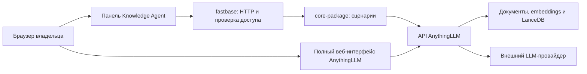

# Knowledge Agent: архитектура первой версии продукта

Статус: решение этапа 1. Оболочка и серверный профиль ещё не реализованы.

## Компоненты и ответственность

- **Панель** — настройка, состояния, загрузка знаний и переход в полный интерфейс. Vanilla HTML/CSS/JS достаточно; сборщик frontend без необходимости не добавляем. Визуальные токены и компоненты — my-design-system.
- **Backend панели** — fastbase, валидированные DTO и внутренние BaseScenario через run(). Один lifecycle core на процесс; предметная логика не размещается в HTTP-обработчиках.
- **AnythingLLM** остаётся готовым отдельным контейнером. Он отвечает за документы, индекс, чат, историю и хранение ключа LLM. Его исходники и встроенный UI не переписываются.
- **Собственная PostgreSQL сейчас не нужна.** event-infra подключается, когда появляется предметное хранение за пределами AnythingLLM. Искусственный SQL/CRUD для соответствия списку зависимостей не создаётся.
- **Docker Compose** объединяет контейнеры. Backend не получает Docker socket и не управляет Docker Engine. Управление процессами выполняют установщик и команды обслуживания.

## Веб-интерфейсы и адреса

Локально: панель на отдельном loopback-порту, планируемый порт 3301; нынешний AnythingLLM остаётся на 3001. В панели есть действие «Открыть AnythingLLM», ведущее на его штатный адрес или конкретное рабочее пространство. Адреса задаются конфигурацией и не содержат токенов.

На сервере: reverse proxy завершает HTTPS и направляет два hostname к соответствующим сервисам. Это сохраняет штатные маршруты и ресурсы AnythingLLM без хрупкой подмены его корневого пути. Реальные домены задаются при развёртывании. Внутренние порты контейнеров не открываются в интернет.

## Контракт оболочки

Планируемый префикс HTTP API панели: `/api/v1`. Точные схемы и ошибки будут закреплены кодом и OpenAPI на этапе 2.

| Действие | Контракт | Результат |
|---|---|---|
| Прочитать состояние | GET /status | Доступность движка, настройка модели, готовность базы; без секретов |
| Прочитать подключение | GET /connection | Провайдер, адрес, модель, лимиты, keyConfigured; ключ не возвращается |
| Сохранить подключение | PUT /connection | Проверка DTO и сохранение в AnythingLLM; пустой ключ сохраняет имеющийся |
| Проверить модель | POST /connection/test | Один реальный короткий запрос; понятный результат или ошибка |
| Рабочие пространства | GET/POST /workspaces | Список и создание через AnythingLLM |
| Документы | GET/POST /workspaces/{slug}/documents | Список и загрузка с проверкой размера/типа |
| Индексация | POST /workspaces/{slug}/index и GET состояния документов | Запуск и фактическая готовность; принятую фоновую задачу не выдаём за завершённую |
| Открыть полный интерфейс | GET /links | Безопасные адреса UI и выбранного рабочего пространства |

Генерация и потоковый чат на первом проходе доступны в штатном UI AnythingLLM. Собственный интерфейс чата не является условием работоспособности панели. Смена LLM не должна менять embedding-модель и требовать повторной индексации.

Для интеграции используем developer API AnythingLLM с сервисным ключом. В установленной версии подтверждены защищённый `/api/v1/system` и `/api/v1/system/update-env`; перед реализацией проверяются контракты остальных используемых операций. Временные обращения к незащищённым внутренним web-ручкам текущего MVP не становятся публичным контрактом продукта.

Сервисный ключ создаёт установочный bootstrap в собственном экземпляре AnythingLLM; результат сохраняется в локальном секретном файле без вывода ключа. На существующем экземпляре сначала проверяется совместимость и режим доступа; настройки и ключи не сбрасываются. Если безопасный bootstrap неприменим, мастер предлагает ввод сервисного ключа владельцем.

## Провайдеры и сессии

Первый профиль — OpenCode Go, базовый заменяемый контракт — OpenAI-compatible API. Другие протоколы подключаются через поддерживаемый профиль, а не обещанием совместимости с любой CLI-подпиской.

Текущий общий x-opencode-session сохраняется только как ограничение демонстрационного запуска. Этап 5 должен обеспечить стабильный идентификатор каждого диалога. Сначала проверяются штатные возможности движка; при их недостаточности выделяется узкий адаптер запросов. Кодинг-клиент или иной продукт не имитируются. До проверки раздельных сессий поддержку нескольких пользователей не объявлять.

## Хранение и ключи

| Данные | Владелец хранения | Git |
|---|---|---|
| Документы, индекс и история | Существующий storage AnythingLLM | Исключены |
| Ключ LLM | Существующая конфигурация AnythingLLM | Исключён; не переносится в исходники |
| Сервисный ключ интеграции, секреты входа | Локальная .secrets, доступ только нужному сервису | Исключены |
| Настройки запуска без секретов | Примеры конфигурации | Включены |
| Образы, версии, инструкция, тестовые документы | Репозиторий и GHCR | Включены |

Панель принимает ключ только при явном сохранении владельцем, не пишет его в access-логи, сообщения об ошибках, URL или localStorage и не возвращает при чтении настроек. Полный запрос/ответ API провайдера с заголовками не журналируется. Сохранение и проверка подключения — разные действия. В форме видно, какому сервису будут отправлены ключ и фрагменты документов.

Перед каждым push запускается `python scripts/check-secrets.py --history`: проверяет отслеживаемые файлы, index и достижимую историю, включая точные локальные секреты, если локальная конфигурация доступна. Значения секретов не печатаются. Проверка снижает риск, но не заменяет просмотр diff и секрет-сканер GitHub.

## Доступ в серверной установке

Продукт первой версии предназначен для владельца: одна роль `owner`. Общая политика разрешений связывает роль с внешними действиями; health имеет отдельное явное гостевое разрешение. Непроверенный заголовок role не назначает права.

Для локального и серверного профиля задаётся секрет владельца. Выбран HTTP Basic Auth: серверный reverse proxy проверяет его для обоих hostname, backend независимо проверяет доступ к своим действиям. Для серверного профиля обязателен HTTPS; технические детали будут закреплены на этапе 2/7. Отсутствие секрета не должно молча включать публичный режим. Настройка домена и реальное размещение выполняются отдельно.

## Сохранение текущего MVP

| Существующая возможность | Решение перехода | Проверка |
|---|---|---|
| Прямой запуск и доступ к AnythingLLM | Сохраняются; оболочка добавляется рядом | Открытие прежнего UI после подключения панели |
| Документы и индекс в storage | Прежний bind mount, без переинициализации | Прежний документ и ответ 45 минут |
| Сохранённый ключ Go | Не копируется в код и не перезаписывается | keyConfigured и реальный ответ без вывода ключа |
| Русская индексация | Прежняя многоязычная модель | Прямой и перефразированный вопросы |
| Настройка в штатном UI | Сохраняется; панель перечитывает актуальное состояние | Изменение настройки видно в панели |
| Перезапуск и обновление документов | Сохраняются | Проверки из verification/acceptance.md |

До изменения Compose делается согласованная локальная резервная копия нужных данных; проверочные установки получают отдельное имя проекта и отдельное хранилище. Никаких down -v, очистки текущей базы и переноса чужих контейнеров.

## Установка и поставка

Этап 6 добавит образ оболочки, сборку в GitHub Actions и публикацию в GHCR репозитория senia-glitch/knowledge-agent. Установщики Windows/Linux получат версионированную конфигурацию и готовые образы, создадут локальные секреты и откроют панель. Условие: Docker уже установлен и запущен; его установка в ОС — отдельная системная операция.

Повторная установка должна сохранять данные и пользовательские настройки. Перед обновлением — резервная копия. До публикации образа проверка локального Docker build не считается проверкой установки готового релиза.

## Приёмка этапа 1

- Зафиксированы компоненты, API-границы, интерфейсы, хранение, доступ и сохранение нынешних функций.
- Текущий контейнер, данные и ключ не менялись при подготовке документа.
- Проверены отсутствие локальных секретов в публикуемых файлах и истории, правила исключения runtime-данных.
- Реализация backend, UI, установки и серверного профиля остаётся этапами 2–7.
